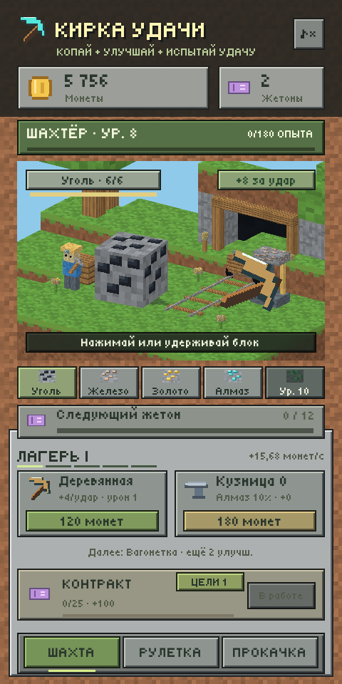
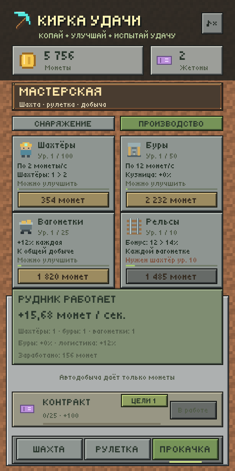
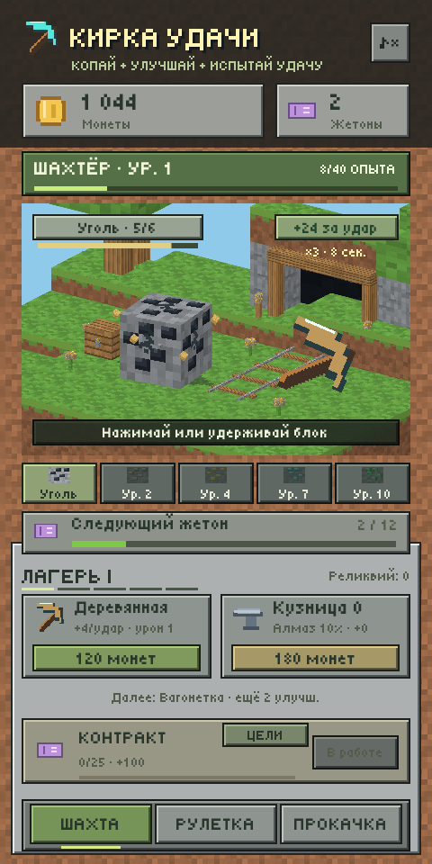

# Кирка удачи / Lucky Pickaxe — 0.12

Unity **2022.3.47f1** (`88c277b85d21`). Игра находится в корне репозитория.

  

[Анимация добычи из демки](Docs/images/ore-animation.gif) · [Повышение уровня](Docs/images/level-up.png).

В 0.12 добавлены шахтёры, буры, вагонетки и рельсы: **Прокачка → Производство**. Они зарабатывают монеты в секунду, пока приложение работает. Кузница усиливает буры, вагонетки увеличивают общий доход, рельсы улучшают каждую вагонетку. В мире появляются шахтёры с движущимися кирками и вращающийся бур. [Начало производства](Docs/images/production-locked.png), [развитое производство](Docs/images/production-max.png), [запись анимаций](Docs/images/production-animation.gif).

За каждые 24 добытых вручную блока появляется **богатая жила**: золотая кнопка рядом с рудой. На сбор отводится 20 секунд; активация на 12 секунд утраивает монеты от ручных ударов и разрушения руды. Опыт, жетоны, награды уровней, рулетка и автоматический доход не умножаются. [Предложение жилы](Docs/images/rich-vein-offer.png).

В 0.11 добавлена **Книга шахтёра**: 16 разовых целей за добычу, рулетку и развитие мастерской. Кнопка **Цели** находится рядом с контрактом на всех трёх вкладках; число на ней показывает готовые награды. Книга открывается на странице с готовой наградой либо первой незабранной целью. Выполненные условия не начисляют монеты автоматически: награду нужно забрать. [Начало книги](Docs/images/milestones-start.png), [получение награды](Docs/images/milestones-claimed.png), [поздние цели](Docs/images/milestones-late.png).

В 0.9 улучшения меняют саму шахту: [развитый рудник](Docs/images/camp-4.png), [запись покупки улучшений](Docs/images/camp-animation.gif). Появляются вагонетка, укрепления входа, работающий подъёмник, алмазные фонари и кузница с дымоходом. Заголовок и пять делений показывают ступень шахты, нижняя подсказка — следующую постройку и число улучшений до неё.

В 0.10 добавлена вкладка **Прокачка** с шестью ветками: кирка, кузница, перестановка, острота, пресс жетонов и сокровища. Четыре новые ветки дают 29 рангов. Перестановка больше не выдаётся по умолчанию: первый ранг покупается за 600 монет с уровня шахтёра 3. Следующие ранги дают два и три обмена на бросок. [Мастерская в начале игры](Docs/images/workshop-locked.png), [три обмена в рулетке](Docs/images/roulette-swap3.png).

После покупки перестановки можно направить алмазную кирку на раскрытый обсидиан или сразу копать: [запись из игры](Docs/images/roulette-exchange.gif), [выбор кирки](Docs/images/roulette-exchange-selected.png). Оплаченный бросок, купленный лимит и потраченные обмены сохраняются при выходе; подтверждение не требует второго жетона. Без улучшения кирки начинают добычу автоматически после остановки барабанов.

В 0.7 исправлены пропорции руды и добавлен риск потерять жетон: [розыгрыш](Docs/images/roulette-animation.gif), [неудача на обсидиане](Docs/images/roulette-loss.gif). Блоки — кубы с одинаковым масштабом по трём осям; окно шахты отрисовывается в собственном размере 432×417 с фильтрацией Point. Обсидиан останавливает слабые кирки, бедрок лишает сундука. Возможен запуск без единой монеты.

## Запуск

Открыть папку через Unity Hub в версии 2022.3.47f1, открыть `Assets/MineLoot/Scenes/Demo.unity` и нажать **Play**. Интерфейс создаётся компонентом `DemoController` при запуске.

Локальная Windows-сборка: `Builds/Windows/MineLoot.exe`. Для переноса нужна вся папка Windows. Сборки и кеши не хранятся в Git.

## Игровой цикл

- Нажимать или удерживать руду. В начале каждые **12 ударов** дают жетон; пресс уменьшает порог до **6**. Начальный доход — **8 монет за удар**.
- Разрушать блоки: уголь → железо → золото → алмаз → изумруд. Доступные руды чередуются; открытие новых зависит от уровня шахтёра. У каждого вида свои прочность, цвет и награда.
- Получать опыт за удары, разрушение руды и блоки рулетки. Новый уровень даёт монеты и жетон; максимум — 50 уровней.
- Улучшать кирку для дохода и урона по руде: дерево → камень → железо → золото → алмаз. Карточка показывает следующий материал и оставшиеся улучшения. Кузница повышает редкость и силу кирок в рулетке.
- Во вкладке **Прокачка** покупать новые ранги за монеты. Карточки показывают текущий и следующий эффект, нужный уровень шахтёра и цену. Острота ускоряет разрушение руды, пресс даёт жетоны чаще, сокровища увеличивают награду сундука.
- В разделе **Производство** нанимать шахтёров и покупать оборудование. Автодобыча даёт только монеты: без ударов по руде, опыта и жетонов. Доход продолжается на всех трёх вкладках и во время рулетки.
- Забирать богатую жилу золотой кнопкой. Её предложение и усиление тратят время только на активном экране шахты без открытого окна или розыгрыша. Во время действующей жилы новые 24 блока не накапливаются.
- За жетон выпадают кирки для активных проходов. Без перестановки они сразу начинают добычу. С купленной перестановкой после остановки можно менять две разные кирки местами: нажать первую, затем вторую. Лимит — 1, 2 или 3 обмена по рангу улучшения. Повторное нажатие отменяет выделение, одинаковые кирки не тратят обмен.
- При открытой перестановке кнопка **Копать · без доплаты** подтверждает расстановку, в том числе без обмена. Кирки наносят урон каждому столбцу; повреждения и добытые блоки сохраняются. Закрытые и потерянные проходы не участвуют в обмене.
- Пока бросок ожидает решения, добыча, все покупки, контракты и смена раскладки заблокированы. После перезапуска сразу открывается этот же выбор: новый жетон не нужен, кирки не перебрасываются и потраченные обмены не возвращаются.
- На каждом новом проходе может быть одно скрытое препятствие: 18% бедрок, 30% обсидиан, 52% без препятствия. Первый слой обычный, препятствие раскрывается при достижении его слоя; раскладка сохраняется.
- Бедрок ломает любую кирку, закрывает проход и лишает его сундука. Обсидиан повреждается только алмазной киркой; дерево и железо ломаются без урона. Повторить попытку можно новой киркой в следующем запуске.
- Пустые и потерянные проходы дают 0 монет. Дополнительная награда за пласт и жетон выдаются только за все 5 сундуков. Пласт завершается, когда каждый проход либо открыт, либо потерян.
- Кнопка **Сменить · 1 жетон** начинает новую раскладку на той же глубине: незабранные сундуки и повреждения оставляются, уровень наград не увеличивается.
- Каждые 3 пласта меняется окружение и увеличивается прочность (до 4). За каждые 3 пласта со всеми пятью сундуками выдаётся реликвия: +1 к доходу за удар. Неудачные и сменённые раскладки не дают дополнительных реликвий.
- Контракты за каждые 25 добытых блоков рулетки дают монеты и жетон; награда забирается кнопкой внизу.
- Следить за книгой целей: в каждой карточке указаны условие, прогресс и разовая награда. Цели можно выполнять и забирать в любом порядке; старый прогресс учитывается. Забранные награды отмечаются в сохранении.
- Кнопка скорости ускоряет анимации вдвое. Звук отключается кнопкой ♪.

## Книга целей

| Цель | Условие | Монеты | Жетоны |
|---|---|---:|---:|
| Первые искры | 30 ударов по руде | 120 | 1 |
| Каменолом | 10 добытых блоков руды | 180 | 1 |
| Искатель удачи | 5 бросков рулетки | 240 | 1 |
| Железный век | Кирка уровня 5 | 300 | 1 |
| Проходчик | 50 разбитых блоков рулетки | 400 | 2 |
| Алмазная жила | Шахтёр уровня 7 | 500 | 2 |
| Первый манёвр | Куплена перестановка | 200 | 1 |
| Верный удар | Острота уровня 3 | 600 | 2 |
| Новый горизонт | Пласт 10 | 800 | 2 |
| Мастер кузницы | Кузница уровня 6 | 1000 | 2 |
| Поток жетонов | Пресс уровня 3 | 900 | 2 |
| Кристальная кирка | Кирка уровня 20 | 1500 | 3 |
| Охотник за кладом | Сокровища уровня 5 | 1400 | 3 |
| Хранитель реликвий | 3 реликвии | 1200 | 3 |
| Опытный шахтёр | Шахтёр уровня 25 | 1800 | 3 |
| Легенда шахты | Шахтёр уровня 50 | 3000 | 5 |

Суммарная разовая награда — **14140 монет и 34 жетона**. Книга использует существующие счётчики прогресса. Открытый оплаченный бросок блокирует книгу и выдачу наград до начала добычи. Сброса по дням и повторной выдачи после перезапуска нет. Награды монет и жетонов ограничены существующими пределами кошелька; на пределе избыток не переносится.

## Производство

Покупки используют тот же кошелёк, ограничения и сохранение, что и снаряжение. `n` — число купленных единиц или текущий ранг до покупки.

| Покупка | Предел | Открытие | Цена следующей | Эффект |
|---|---:|---|---|---|
| Шахтёры | 100 | Шахтёр ур. 2 | `round(300 × 1.18^n)` | По 2 монеты/с |
| Буры | 50 | Шахтёр ур. 5 и один рабочий | `round(1800 × 1.24^n)` | По 12 монет/с; +10% за каждый уровень кузницы |
| Вагонетки | 25 | Шахтёр ур. 8 и один бур | `round(1400 × 1.30^n)` | Каждая добавляет 10% к общему производству |
| Рельсы | 10 | Шахтёр ур. `8 + 2n` и вагонетка | `round(900 × 1.65^n)` | +2 процентных пункта к эффекту каждой вагонетки за ранг |

Итог в монетах/с: `(2 × шахтёры + 12 × буры × (1 + кузница / 10)) × (1 + вагонетки × (10 + 2 × рельсы) / 100)`. Например, один шахтёр, один бур, одна вагонетка и рельсы уровня 1 при кузнице 0 дают `(2 + 12) × 1.12 = 15.68` монеты/с. Предел при всех максимальных рангах и кузнице 10 — `11900` монет/с. Дробные монеты переносятся между кадрами и сохраняются, округления вверх нет.

Пока игра открыта, производство работает и при ожидании расстановки кирок. Покупки во время оплаченного броска заблокированы; пассивные монеты не меняют выпавшие кирки и не дают повторной награды. При приостановке приложения доход останавливается; офлайн-дохода за закрытую игру пока нет.

## Мастерская: снаряжение

Ранг `n` в формулах — текущий ранг до покупки, начиная с 0. Требования относятся к следующему рангу. Цены округляются до целой монеты.

| Ветка | Рангов | Уровень шахтёра для покупки | Цена следующего ранга | Эффект |
|---|---:|---|---|---|
| Кирка | 100 | 1 | `round(120 × 1.28^n)` | +4 монеты за удар; урон и материал по порогам |
| Кузница | 10 | 1 | `round(180 × 1.42^n)` | Редкость и сила кирок рулетки |
| Перестановка | 3 | 3 / 8 / 15 | 600 / 2400 / 9600 | 1 / 2 / 3 обмена кирок в одном броске |
| Острота | 10 | `2 + 2n` | `round(300 × 1.58^n)` | +1 урон по руде за ранг |
| Пресс жетонов | 6 | `4 + 3n` | `round(550 × 1.9^n)` | −1 удар для жетона за ранг: 12 → 6 |
| Сокровища | 10 | `6 + 2n` | `round(800 × 1.65^n)` | +15% базовой награды сундука за ранг: до +150% |

Покупка пресса сохраняет накопленные удары: если новый порог уже достигнут, жетон выдаётся сразу, остаток переносится. Новые ветки не меняют ограничения бедрока и обсидиана.

## Развитие шахты

Постройки открываются вместе с уже существующими улучшениями. Отдельной платы за оформление нет; внешний вид восстанавливается по сохранённым уровням кирки и кузницы. Декоративная вагонетка и подъёмник сами по себе не начисляют монеты: доход задают покупки раздела «Производство». Купленная производственная вагонетка тоже включает её модель в мире. При 1/5/10 рабочих видны 1/2/3 шахтёра; большее количество учитывается в доходе без создания новых фигур.

| Уровень улучшения кирки | Ступень | Изменение мира |
|---|---|---|
| 0 | Лагерь I | Деревянный вход и ящик припасов |
| 2 | Штольня II | Вагонетка с углём, движение по рельсам |
| 5 | Рудник III | Каменные основания, металлические крепления, железная вагонетка |
| 12 | Прииск IV | Подъёмник с движущимся ковшом, золото в вагонетке |
| 20 | Алмазный V | Алмазные фонари, вращающийся знак и алмазная загрузка |

| Уровень кузницы | Новое оснащение |
|---|---|
| 1 | Печь с огнём и наковальня |
| 3 | Дымоход с дымом и стойка инструментов |
| 6 | Деревянный навес с черепичной крышей |
| 10 | Латунные детали и слитки мастера |

Новая постройка появляется с коротким увеличением и осколками. Покупки кирки и кузницы записываются сразу. Повторное обновление интерфейса переиспользует подготовленную геометрию.

## Баланс

| Параметр | Формула |
|---|---|
| Старт | 80 монет, 2 жетона |
| Доход за удар | `8 + 4 × уровень кирки + реликвии` |
| Богатая жила | ×3 к монетам удара и разрушения руды на 12 секунд; предложение после 24 блоков, 20 секунд на сбор |
| Урон по руде | `1 + floor(уровень кирки / 5) + острота`; один удар разрушает не более одного блока |
| Ударов для жетона | `12 − пресс жетонов` |
| Материалы кирки | камень после 2 улучшений, железо — 5, золото — 12, алмаз — 20 |
| Опыт | 1 за удар; дополнительно `6 + 4 × индекс руды` за разрушение; 1 за блок рулетки |
| Суммарный опыт для уровня L | `(L−1) × (L+2) × 10`; L от 1 до 50 |
| Награда за новый уровень L | `40 × L` монет и 1 жетон |
| Цена кирки | `round(120 × 1.28^уровень)` |
| Цена кузницы | `round(180 × 1.42^уровень)`; максимум 10 уровней |
| Редкость при кузнице 0 | дерево 55%, железо 35%, алмаз 10% |
| Редкость при кузнице L | дерево `55−2L`%, железо `35+L`%, алмаз `10+L`% |
| Сила кирки | `1 / 2 / 4 + floor(L/2)` |
| Прочность породы | `min(4, 1 + floor((пласт−1)/3))` |
| Блок | `6 + 2 × min(99, пласт−1)` монет |
| Сундук | `floor((60 + 20 × min(99, пласт−1)) × (100 + 15 × сокровища) / 100)` монет |
| Все пять сундуков | `100 + 30 × min(99, пласт−1)` монет и жетон дополнительно |
| Открытый или потерянный проход | 0 монет, без компенсации |
| Обмен кирок | закрыт до покупки; 1 / 2 / 3 обмена двух разных кирок по рангу перестановки, без доплаты за применение |
| Подтверждение добычи | без дополнительного списания жетона |
| Обсидиан | `обычная прочность + 2`, урон только алмазной киркой |
| Бедрок | не разрушается; сундук этого прохода теряется |
| Смена раскладки | 1 жетон; без повышения пласта и уровня наград |
| Контракт N, начиная с 0 | цель `25 × (N+1)` блоков всего; `100 + 40 × min(1000,N)` монет и жетон |

| Руда | Уровень открытия | Прочность | Монеты за разрушение |
|---|---:|---:|---:|
| Уголь | 1 | 6 | 12 |
| Железо | 2 | 9 | 28 |
| Золото | 4 | 12 | 55 |
| Алмаз | 7 | 16 | 95 |
| Изумруд | 10 | 20 | 150 |

Результаты воспроизводимой симуляции: [Docs/Balance.md](Docs/Balance.md). Это проверка экономики при заданном поведении бота; темп для реальных игроков требует плейтестов.

## Графика, звук и сохранения

Сохранён воксельный стиль: настоящая 3D-поляна, кубический блок руды, деревья, рельсы и вход в штольню. В 0.5 добавлены три стадии трещин, короткая вспышка удара, отдача кирки, осколки с траекториями и появление нового блока с упругим масштабированием. Полосы прочности и опыта двигаются плавно; новые уровни и материалы кирки показываются уведомлением. Кирки рулетки останавливаются по очереди, плавно опускаются к породе; сундуки реагируют на открытие. UI — квадратные панели под инвентарь. Шрифт Tiny5 с кириллицей; текстуры 16/32 px созданы кодом. Подробности и лицензия — [Docs/Art.md](Docs/Art.md). `GameAudio` создаёт разные короткие звуки для камня, металла, кристаллов и повышения уровня.

Прогресс хранится локально через JSON/PlayerPrefs с резервной копией. Формат v8 дополнительно хранит производство, дробную монету, сумму произведённого дохода и оставшееся время богатой жилы. Сохранения v1–v7 читаются автоматически: монеты, жетоны, прежние улучшения, цели, глубина, опыт, повреждения и бюджет обменов сохраняются. Старые счётчики не выдают бесплатные машины, прошлые жилы и доход за отсутствие. Старые достижения не оплачиваются автоматически; подходящие цели доступны для ручного получения. В сохранениях до v6 постоянная перестановка закрыта до покупки. Только уже оплаченный незавершённый бросок v5 сохраняет прежнее право на один обмен с учётом его использования; следующий бросок использует купленный ранг. В существующий пласт версий v1/v2/v3 ловушки не вставляются: они появятся на следующем пласте либо после кнопки «Сменить». Для v1/v2 прошлые клики засчитываются в опыт без повторной выдачи наград за уровни. Ключ сохранения и идентификаторы приложения сохранены.

Обычные клики, производство и таймер жилы записываются пачкой раз в 3 секунды и при потере фокуса; разрушение руды, повышение уровня, все покупки, смена раскладки, контракты, награды целей, активация и истечение жилы сохраняются сразу. При аварийном завершении возможна потеря последних нескольких секунд прогресса. В рулетке списание жетона и кирки записываются перед прокруткой, каждый обмен — перед перемещением значков, награда — перед анимацией ударов. Загрузка продолжает незавершённый выбор, повреждённый бросок восстанавливается из резервной копии.

## Проверки

Меню **Mine Loot → Verify game rules**, **Simulate balance**, **Build Windows demo**.

```powershell
& 'C:\Program Files\Unity\Hub\Editor\2022.3.47f1\Editor\Unity.exe' -batchmode -quit -projectPath $PWD.Path -executeMethod DemoTools.VerifyAndBuild -logFile "$PWD\Logs\build.log"
Start-Process '.\Builds\Windows\MineLoot.exe' -ArgumentList '-demoSmokeTest', '-demoOutput', "$PWD\Logs", '-logFile', "$PWD\Logs\runtime.log" -WindowStyle Hidden -Wait
```

Проверочный запуск использует отдельный прогресс и не меняет сохранения игрока. Проверяются кнопки, кошелёк, улучшения, контракты, розыгрыш, блокировка повторного запуска и размещение кнопок в разных размерах окна. Артефакты проверки: `Logs/rules-check.json`, `Logs/build-summary.json`, `Logs/runtime-check.json`, `Logs/balance-runs.csv`, `Logs/unity-*.png`.

Результаты проверки версии 0.12: [Docs/Verification.md](Docs/Verification.md).

## Файлы

- `Assets/MineLoot/Scripts/MineGame.cs` — экономика и прогрессия без зависимостей от сцены.
- `DemoController.cs` — управление и эффекты; `DemoController.UI.cs` — компоновка экранов, типографика и оформление контролов того же компонента.
- `PixelArt.cs`, `GameAudio.cs` — графика и звук.
- `VoxelStage.cs`, `Resources/VoxelWorld.shader`, `Resources/VoxelShadow.shader` — 3D-диорамы, группировка геометрии по текстурам, освещение граней и контактная тень.
- `VoxelStage.Expedition.cs` расширяет тот же компонент для рулетки: 25 блоков, пять сундуков, освещение граней, факелы и повреждения. Работает камера только текущего экрана; миры пространственно изолированы.
- `VoxelStage.Development.cs` расширяет тот же компонент для построек, вагонетки, подъёмника, кузницы, рабочих, бура и искр богатой жилы. Использует общие сборку граней, материалы и пул осколков; новый MonoBehaviour не добавляется.
- `ProgressStore.cs` — сохранение, миграция и резервная копия.
- `DemoSmokeCheck.cs` — проверка собранного приложения по флагу.
- `Assets/MineLoot/Editor/DemoTools.cs` — сцена, правила, симуляция и сборка.
- `_test-concept/` — локальные эксперименты, исключены из Git.

## Ограничения

Windows-демка, без SDK Яндекс Игр/RuStore, рекламы, платежей и облачных сохранений. WebGL-модуль для установленного редактора отсутствует; APK и работа на Android-устройстве не проверены. PlayerPrefs не защищает прогресс от редактирования. Интерфейс остаётся портретным и вписывается в широкое окно; ландшафтная компоновка не сделана. Для публикации нужна интеграция выбранной площадки и отдельная проверка её требований.
