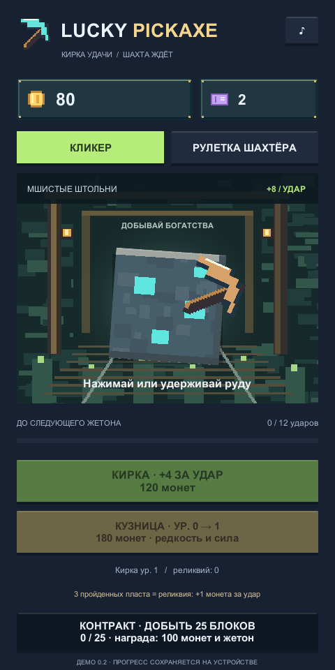
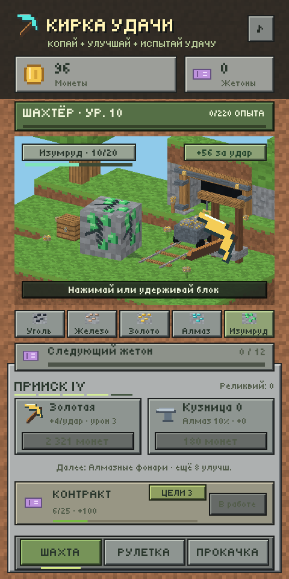
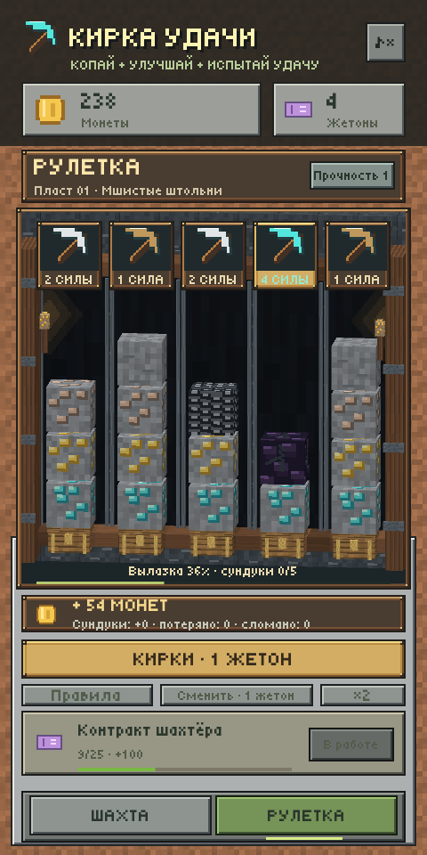

# Кирка удачи / Lucky Pickaxe — 0.8

Unity **2022.3.47f1** (`88c277b85d21`). Игра находится в корне репозитория.

  

[Анимация добычи из демки](Docs/images/ore-animation.gif) · [Повышение уровня](Docs/images/level-up.png).

В 0.8 добавлен один бесплатный обмен двух выпавших кирок перед ударом: [запись из игры](Docs/images/roulette-exchange.gif), [выбор кирки](Docs/images/roulette-exchange-selected.png). Можно направить алмазную кирку на раскрытый обсидиан или сразу копать без обмена. Оплаченный бросок и использованный обмен сохраняются при выходе; подтверждение не требует второго жетона.

В 0.7 исправлены пропорции руды и добавлен риск потерять жетон: [розыгрыш](Docs/images/roulette-animation.gif), [неудача на обсидиане](Docs/images/roulette-loss.gif). Блоки — кубы с одинаковым масштабом по трём осям; окно шахты отрисовывается в собственном размере 432×417 с фильтрацией Point. Обсидиан останавливает слабые кирки, бедрок лишает сундука. Возможен запуск без единой монеты.

## Запуск

Открыть папку через Unity Hub в версии 2022.3.47f1, открыть `Assets/MineLoot/Scenes/Demo.unity` и нажать **Play**. Интерфейс создаётся компонентом `DemoController` при запуске.

Локальная Windows-сборка: `Builds/Windows/MineLoot.exe`. Для переноса нужна вся папка Windows. Сборки и кеши не хранятся в Git.

## Игровой цикл

- Нажимать или удерживать руду. Каждые **12 ударов** дают жетон. Начальный доход — **8 монет за удар**.
- Разрушать блоки: уголь → железо → золото → алмаз → изумруд. Доступные руды чередуются; открытие новых зависит от уровня шахтёра. У каждого вида свои прочность, цвет и награда.
- Получать опыт за удары, разрушение руды и блоки рулетки. Новый уровень даёт монеты и жетон; максимум — 50 уровней.
- Улучшать кирку для дохода и урона по руде: дерево → камень → железо → золото → алмаз. Карточка показывает следующий материал и оставшиеся улучшения. Кузница повышает редкость и силу кирок в рулетке.
- За жетон выпадают кирки для активных проходов. После остановки барабанов можно один раз бесплатно поменять две разные кирки местами: нажать первую, затем вторую. Повторное нажатие на выбранную кирку отменяет выделение, одинаковые кирки не тратят обмен.
- Кнопка **Копать · без доплаты** подтверждает расстановку, в том числе без обмена. Кирки наносят урон каждому столбцу; повреждения и добытые блоки сохраняются. Закрытые и потерянные проходы не участвуют в обмене.
- Пока бросок ожидает решения, добыча, улучшения, контракты и смена раскладки заблокированы. После перезапуска сразу открывается этот же выбор: новый жетон не нужен, кирки не перебрасываются и использованный обмен не возвращается.
- На каждом новом проходе может быть одно скрытое препятствие: 18% бедрок, 30% обсидиан, 52% без препятствия. Первый слой обычный, препятствие раскрывается при достижении его слоя; раскладка сохраняется.
- Бедрок ломает любую кирку, закрывает проход и лишает его сундука. Обсидиан повреждается только алмазной киркой; дерево и железо ломаются без урона. Повторить попытку можно новой киркой в следующем запуске.
- Пустые и потерянные проходы дают 0 монет. Дополнительная награда за пласт и жетон выдаются только за все 5 сундуков. Пласт завершается, когда каждый проход либо открыт, либо потерян.
- Кнопка **Сменить · 1 жетон** начинает новую раскладку на той же глубине: незабранные сундуки и повреждения оставляются, уровень наград не увеличивается.
- Каждые 3 пласта меняется окружение и увеличивается прочность (до 4). За каждые 3 пласта со всеми пятью сундуками выдаётся реликвия: +1 к доходу за удар. Неудачные и сменённые раскладки не дают дополнительных реликвий.
- Контракты за каждые 25 добытых блоков рулетки дают монеты и жетон; награда забирается кнопкой внизу.
- Кнопка скорости ускоряет анимации вдвое. Звук отключается кнопкой ♪.

## Баланс

| Параметр | Формула |
|---|---|
| Старт | 80 монет, 2 жетона |
| Доход за удар | `8 + 4 × уровень кирки + реликвии` |
| Урон по руде | `1 + floor(уровень кирки / 5)`; один удар разрушает не более одного блока |
| Материалы кирки | камень после 2 улучшений, железо — 5, золото — 12, алмаз — 20 |
| Опыт | 1 за удар; дополнительно `6 + 4 × индекс руды` за разрушение; 1 за блок рулетки |
| Суммарный опыт для уровня L | `(L−1) × (L+2) × 10`; L от 1 до 50 |
| Награда за новый уровень L | `40 × L` монет и 1 жетон |
| Цена кирки | `round(120 × 1.28^уровень)` |
| Цена кузницы | `round(180 × 1.42^уровень)`; максимум 10 уровней |
| Редкость при кузнице 0 | дерево 55%, железо 35%, алмаз 10% |
| Редкость при кузнице L | дерево `55−2L`%, железо `35+L`%, алмаз `10+L`% |
| Сила кирки | `1 / 2 / 4 + floor(L/2)` |
| Прочность породы | `min(4, 1 + floor((пласт−1)/3))` |
| Блок | `6 + 2 × min(99, пласт−1)` монет |
| Сундук | `60 + 20 × min(99, пласт−1)` монет |
| Все пять сундуков | `100 + 30 × min(99, пласт−1)` монет и жетон дополнительно |
| Открытый или потерянный проход | 0 монет, без компенсации |
| Обмен кирок | один бесплатный обмен двух разных кирок в активных проходах до удара |
| Подтверждение добычи | без дополнительного списания жетона |
| Обсидиан | `обычная прочность + 2`, урон только алмазной киркой |
| Бедрок | не разрушается; сундук этого прохода теряется |
| Смена раскладки | 1 жетон; без повышения пласта и уровня наград |
| Контракт N, начиная с 0 | цель `25 × (N+1)` блоков всего; `100 + 40 × min(1000,N)` монет и жетон |

| Руда | Уровень открытия | Прочность | Монеты за разрушение |
|---|---:|---:|---:|
| Уголь | 1 | 6 | 12 |
| Железо | 2 | 9 | 28 |
| Золото | 4 | 12 | 55 |
| Алмаз | 7 | 16 | 95 |
| Изумруд | 10 | 20 | 150 |

Результаты воспроизводимой симуляции: [Docs/Balance.md](Docs/Balance.md). Это проверка экономики при заданном поведении бота; темп для реальных игроков требует плейтестов.

## Графика, звук и сохранения

Сохранён воксельный стиль: настоящая 3D-поляна, кубический блок руды, деревья, рельсы и вход в штольню. В 0.5 добавлены три стадии трещин, короткая вспышка удара, отдача кирки, осколки с траекториями и появление нового блока с упругим масштабированием. Полосы прочности и опыта двигаются плавно; новые уровни и материалы кирки показываются уведомлением. Кирки рулетки останавливаются по очереди, плавно опускаются к породе; сундуки реагируют на открытие. UI — квадратные панели под инвентарь. Шрифт Tiny5 с кириллицей; текстуры 16/32 px созданы кодом. Подробности и лицензия — [Docs/Art.md](Docs/Art.md). `GameAudio` создаёт разные короткие звуки для камня, металла, кристаллов и повышения уровня.

Прогресс хранится локально через JSON/PlayerPrefs с резервной копией. Формат v5 хранит seed раскладки, потерянные проходы, число неудачных пластов, оплаченные выпавшие кирки и использованный обмен. Сохранения v1/v2/v3/v4 читаются автоматически: монеты, жетоны, улучшения, глубина, опыт и повреждения сохраняются. В существующий пласт версий v1/v2/v3 ловушки не вставляются: они появятся на следующем пласте либо после кнопки «Сменить». Для v1/v2 прошлые клики засчитываются в опыт без повторной выдачи наград за уровни. Ключ сохранения и идентификаторы приложения сохранены. Обычные клики записываются пачкой раз в 3 секунды и при потере фокуса; разрушение руды, повышение уровня, смена раскладки и контракты сохраняются сразу. При аварийном завершении возможна потеря последних нескольких обычных кликов. В рулетке списание жетона и кирки записываются перед прокруткой, обмен — перед перемещением значков, награда — после подтверждения, перед анимацией ударов. Загрузка продолжает незавершённый выбор, повреждённый бросок восстанавливается из резервной копии.

## Проверки

Меню **Mine Loot → Verify game rules**, **Simulate balance**, **Build Windows demo**.

```powershell
& 'C:\Program Files\Unity\Hub\Editor\2022.3.47f1\Editor\Unity.exe' -batchmode -quit -projectPath $PWD.Path -executeMethod DemoTools.VerifyAndBuild -logFile "$PWD\Logs\build.log"
Start-Process '.\Builds\Windows\MineLoot.exe' -ArgumentList '-demoSmokeTest', '-demoOutput', "$PWD\Logs", '-logFile', "$PWD\Logs\runtime.log" -WindowStyle Hidden -Wait
```

Проверочный запуск использует отдельный прогресс и не меняет сохранения игрока. Проверяются кнопки, кошелёк, улучшения, контракты, розыгрыш, блокировка повторного запуска и размещение кнопок в разных размерах окна. Артефакты проверки: `Logs/rules-check.json`, `Logs/build-summary.json`, `Logs/runtime-check.json`, `Logs/balance-runs.csv`, `Logs/unity-*.png`.

Результаты проверки версии 0.8: [Docs/Verification.md](Docs/Verification.md).

## Файлы

- `Assets/MineLoot/Scripts/MineGame.cs` — экономика и прогрессия без зависимостей от сцены.
- `DemoController.cs` — управление и эффекты; `DemoController.UI.cs` — компоновка экранов, типографика и оформление контролов того же компонента.
- `PixelArt.cs`, `GameAudio.cs` — графика и звук.
- `VoxelStage.cs`, `Resources/VoxelWorld.shader`, `Resources/VoxelShadow.shader` — 3D-диорамы, группировка геометрии по текстурам, освещение граней и контактная тень.
- `VoxelStage.Expedition.cs` расширяет тот же компонент для рулетки: 25 блоков, пять сундуков, освещение граней, факелы и повреждения. Работает камера только текущего экрана; миры пространственно изолированы.
- `ProgressStore.cs` — сохранение, миграция и резервная копия.
- `DemoSmokeCheck.cs` — проверка собранного приложения по флагу.
- `Assets/MineLoot/Editor/DemoTools.cs` — сцена, правила, симуляция и сборка.
- `_test-concept/` — локальные эксперименты, исключены из Git.

## Ограничения

Windows-демка, без SDK Яндекс Игр/RuStore, рекламы, платежей и облачных сохранений. WebGL-модуль для установленного редактора отсутствует; APK и работа на Android-устройстве не проверены. PlayerPrefs не защищает прогресс от редактирования. Интерфейс остаётся портретным и вписывается в широкое окно; ландшафтная компоновка не сделана. Для публикации нужна интеграция выбранной площадки и отдельная проверка её требований.
